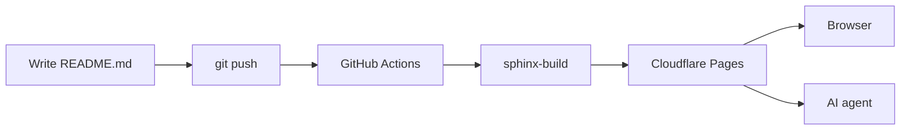
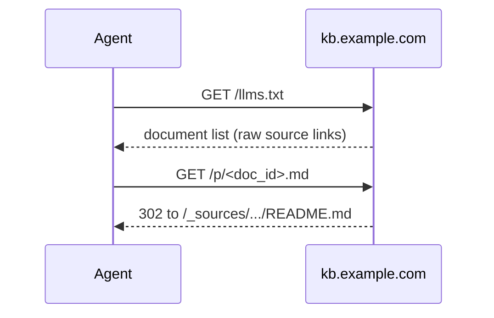

# mermaid and SVG

## mermaid

Write a plain ```` ```mermaid ```` fence (not ```` ```{mermaid} ````). `myst_fence_as_directive = ["mermaid"]` makes the same block preview in PyCharm / GitHub and render through sphinxcontrib-mermaid in the Sphinx build.



### Sequence diagram



## SVG file

Keep the SVG file in the document's folder and use the plain Markdown image syntax; GitHub shows it too:


## Inline SVG

SVG markup written straight into the Markdown is passed through as raw HTML:

<svg xmlns="http://www.w3.org/2000/svg" viewBox="0 0 200 60" width="200" height="60">
  <circle cx="30" cy="30" r="24" fill="#e91e63"/>
  <rect x="70" y="8" width="44" height="44" fill="#3f51b5"/>
  <polygon points="150,6 176,54 124,54" fill="#009688"/>
</svg>
